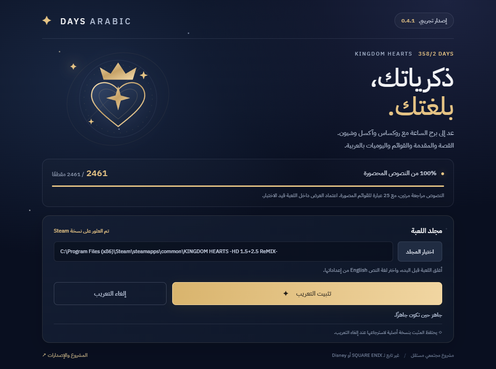
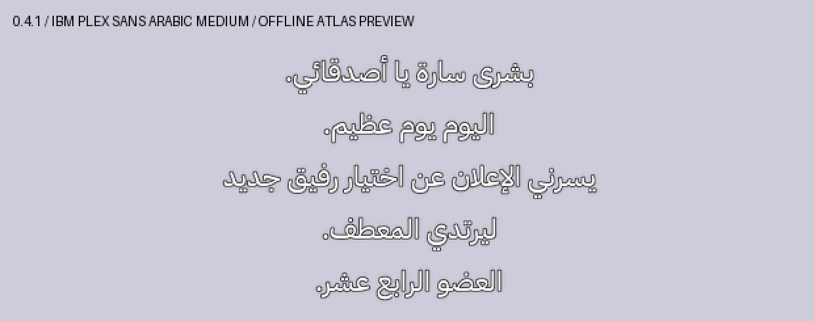

# Days Arabic · تعريب 358/2 Days

تعريب مجتمعي لـ **KINGDOM HEARTS 358/2 Days — HD cutscene compilation** ضمن نسخة Steam من **KINGDOM HEARTS -HD 1.5+2.5 ReMIX-**.

**0.4.1: اكتمال النصوص المحصورة — 2461 / 2461 نصا.** يشمل الحوارات والمقدمة والسرد والفصول والقوائم ويوميات روكساس والتقارير السرية وأوصاف الشخصيات. يضيف الإصدار **845 نصا**، مع مراجعتين مستقلتين للدفعة الجديدة مقابل الإنجليزية الأصلية وتصحيح **55 سجلا** من المسودات. الحوارات الـ1616 تحتفظ بمراجعات 0.4.0 المثبتة ببصماتها؛ النصوص السابقة مجمدة دون تغيير.

صححنا الحصر القديم: **2556 = 2461 نصا قابلا للترجمة + 95 مفتاحا تقنيا للمشاهد**، مثل `hd503 hd504`. تبقى المفاتيح كما هي كي تعمل اللعبة. النسبة **100% للنصوص المحددة في تسعة ملفات CTD**؛ أما الكتابات الزخرفية المدمجة في بعض صور المشاهد، مثل **WINNER** و**OPERATIONS CLOSED FOR VACATION**، فما زالت بالإنجليزية، وتحتاج الصور إلى حصر كامل. شعارات الناشرين والعلامات والأسماء في التترات محفوظة. عرض الخط والقوائم واليوميات داخل اللعبة لم يعتمد بصريا بعد.

تُرجمت أيضا **25 عبارة من القوائم المصورة**، منها التشغيل والفصول والإضافات والإعدادات والإيقاف المؤقت. حافظ البناء على حدود العناصر وأبعاد الصور والشفافية الأصلية، وكل البكسلات خارج مناطق النص. الخط **IBM Plex Sans Arabic Medium** هو ملف الخط نفسه المستخدم في KH2FM، مع اتصال الحروف والترقيم والمسافات العربية.

معاينة الخط خارج اللعبة:

[معاينة عبارات القوائم المصورة خارج اللعبة](docs/ui-art-preview.png) — ليست لقطة تثبت عرضها داخل اللعبة.

## التنزيل

الإصدار التجريبي [v0.4.1](https://github.com/exelight7/KH385-2FM_AR/releases/tag/v0.4.1). المستودع والتنزيلات عامة باختيار صاحب المشروع.

| النظام | التحميل |
|---|---|
| Windows — تثبيت | [Setup EXE](https://github.com/exelight7/KH385-2FM_AR/releases/download/v0.4.1/Days-Arabic-Setup-0.4.1.exe) |
| Windows — إلغاء | [Uninstall EXE](https://github.com/exelight7/KH385-2FM_AR/releases/download/v0.4.1/Days-Arabic-Uninstall-0.4.1.exe) |
| Linux x64 | [AppImage](https://github.com/exelight7/KH385-2FM_AR/releases/download/v0.4.1/Days-Arabic-0.4.1.AppImage) |

1. أغلق اللعبة وشغل المثبت. على Linux امنح AppImage صلاحية التنفيذ من خصائصه.
2. اختر مجلد اللعبة أو `Image` إن لم يعثر البرنامج على مكتبة Steam.
3. اضغط **تثبيت التعريب**. يحتاج إلى نحو 6 غيغابايت حرة للنسخ الاحتياطي وتجهيز الملفات.
4. أعد تشغيل اللعبة بالكامل واختر **English** للنص، ثم افتح **358/2 Days**.

يدعم التحديث المباشر من **0.1.0 و0.2.0 و0.3.0 و0.4.0** ويحفظ النسخة الأصلية نفسها. في فصل **Number XIV (Day 7)** يبدأ إعلان زيمناس بـ **«بشرى سارة يا أصدقائي. اليوم يوم عظيم.»**. افتح الإضافات لاختبار يوميات روكساس والتقارير السرية.

AppImage يوفر التثبيت والإلغاء لنسخة Steam/Proton، وقد تحتاج توزيعتك FUSE 2. عرض التعريب داخل اللعبة على Linux لم يختبر بعد.

## الإلغاء والاسترجاع

افتح **Days-Arabic-Uninstall-0.4.1.exe** واضغط **إلغاء التعريب**، أو استخدم الزر نفسه داخل المثبت/AppImage. يسترجع البرنامج `Mare.hed` و`Mare.pkg` من `Image/.days-arabic-backup`. احتفظ بهذا المجلد؛ لا تسترجع اللعبة بحذف ملفات Mare.

يرفض المثبت البصمات غير المعروفة والتعديلات الأخرى. إن انقطعت العملية، افتحه مجددا بعد إغلاق اللعبة. عند رفض صلاحية الكتابة في مكتبة Steam على Windows، استخدم «تشغيل كمسؤول».

## التحقق والنطاق

- مراجعتان مستقلتان لجميع النصوص المشمولة، مع مصدر مراجعات الحوارات المجمدة في [تقرير الجودة](translation/v0.4.1/quality-report.json) و[تقارير المراجعة](translation/v0.4.1/reviews).
- إعادة تركيب 92 ملف CTD أصليا دون اختلاف، وفحص الإنجليزية والمعرفات والتخطيطات والأوامر والأسطر الفارغة. حفظ المفاتيح التقنية الـ95 حرفيا.
- تحديث 1568 معرف حوار داخل 121 جدول EXIA2، مع حفظ التوقيت والخصائص واللغات الأخرى. بعض حقول الإنجليزية المضمنة فارغة أو مختصرة؛ المرجع هو CTD الأصلي.
- فحص الخط واتصال الحروف؛ 216 فحص اتصال، وصفر تحذيرات لتجاوز حد العرض. المعاينات محلية خارج اللعبة.
- إعادة استخراج الأصول الـ136 المعدلة ومطابقة SHA-256، مع حفظ كل سجلات Mare الـ2024 والبيانات الأصلية داخل PKG، ومنها السجلات غير المعروفة الـ57.
- 13 اختبارا للتثبيت والإلغاء والترقية ورفض التلف والاسترجاع بعد الانقطاع، إضافة إلى اختبار الترقية والإزالة على نسخة كاملة منفصلة واسترجاع الأصل.

تشمل الملفات المشتركة بعض أسماء فصول Re:coded وأوصاف شخصياته ورسائل اختيار الألعاب. **قصة Re:coded وقصة KH1 وKH2 خارج نطاق هذا التعريب**. اكتمال ملفات النص لا يقيس الصور المتبقية أو مدة الفيديو أو الاعتماد البصري.

تم تركيب **0.4.1** على نسخة صاحب المشروع بعد اختبار النسخة المنفصلة؛ [سجل التثبيت](technical/verification/v0.4.1-install.json) يثبت تطابق الحزمة وسلامة النسخة الأصلية الاحتياطية. لم تشغل اللعبة تلقائيا. لقطة المستخدم السابقة تثبت ظهور العربية في 0.2.0 فقط؛ العرض الحالي يحتاج فحصا داخل اللعبة.

الحزمة تحفظ الفيديو الأصلي دون إعادة ترميز. سبب ملاحظة المستخدم اختلاف جودة المشهد لم يحسم، ولم تجر مقارنة المشهد نفسه بعد الإلغاء. [فحص الفيديو السابق](technical/verification/video-integrity.json) و[فحص الأرشيف الحالي](technical/verification/v0.4.1-archive.json).

## المساهمة والبناء

النصوص في [translation/v0.4.1](translation/v0.4.1)، والقواعد في [STYLE.md](translation/full/STYLE.md). لا ترفع ملفات اللعبة الأصلية أو نسخها الاحتياطية.

داخل `installer`: نفذ `npm ci` ثم `npm test` ثم `npm run build:win` أو `npm run build:linux`، وبعدها `node release.cjs`. يبني GitHub Actions الحزمتين وينشر إصدارا تجريبيا جديدا عند تغيير رقم النسخة. تعليمات إعادة بناء النص والأطلس من نسخة مملوكة في [technical/README.md](technical/README.md).

`installer/patch` حزمة فروق XOR تتطلب النسخة المطابقة من اللعبة. خط Plex مرفق بترخيص SIL OFL في `font-rtl/fonts/OFL.txt` وداخل التطبيق.

## الشكر والترخيص

استعمل المشروع أدوات [LittleBitUA](https://github.com/LittleBitUA/KINGDOM-HEARTS-LOCALIZATION-TOOL) لقراءة CTD وكتابته، و[OpenKH](https://github.com/OpenKH/OpenKh) لترميز الأصول. الملكية الفكرية للعبة والشخصيات والعلامات لأصحابها. مشروع مستقل غير تابع إلى Disney أو SQUARE ENIX.

كود المشروع بترخيص GPL-3.0 كما في [LICENSE](LICENSE). لا يمنح الترخيص حقوقا في اللعبة أو العلامات أو الخطوط الأصلية.
